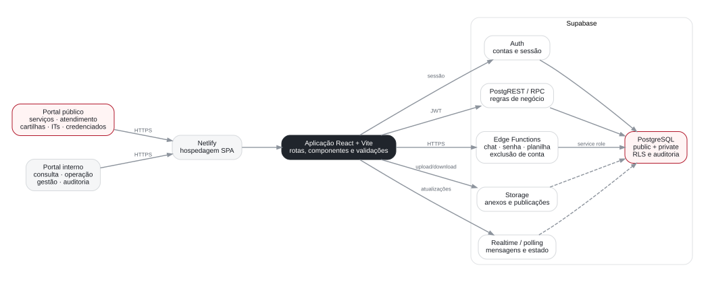
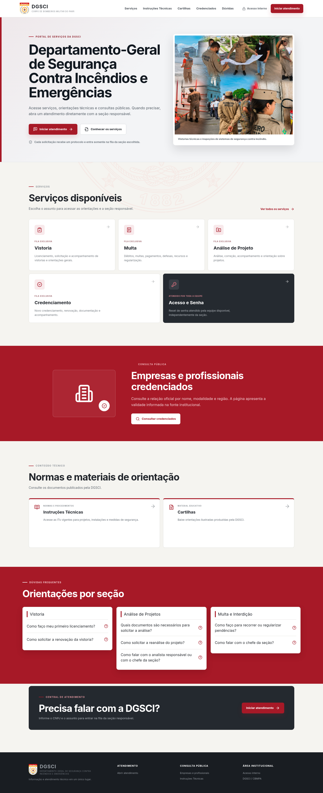
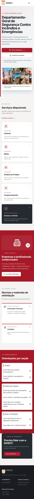
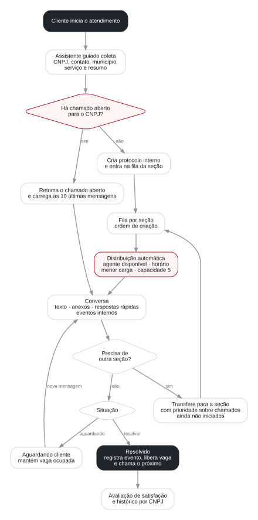
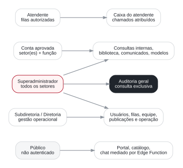
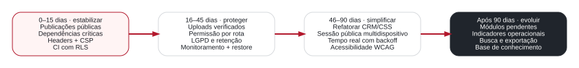

Corpo de Bombeiros Militar do Pará · DGSCI

<h1>Documentação completa e auditoria do sistema</h1>

Funcionamento, arquitetura, perfis, atendimento on-line, segurança, experiência de uso e plano de evolução.

<strong>Departamento-Geral de Segurança Contra Incêndios e Emergências</strong> Portal público e sistema interno

<strong>Revisão técnica</strong> 9 de novembro de 2026 Versão 1.1

# Como usar este documento

Este documento reúne a descrição do produto e uma auditoria técnica baseada no código da versão analisada. Ele serve como manual de operação, referência para manutenção e lista priorizada de melhorias.

O exame incluiu rotas, componentes React, banco e políticas RLS, Edge Functions, Storage, scripts de teste, documentação existente, configuração de hospedagem, dependências, build e navegação local em desktop e celular. Não foi realizado teste de invasão contra o ambiente de produção, restauração real de backup nem teste destrutivo com dados institucionais.

1. **Visão executiva** — estado atual e decisões imediatas.
2. **Funcionamento do sistema** — portal, atendimento e módulos internos.
3. **Arquitetura e dados** — componentes, permissões e integrações.
4. **Auditoria** — segurança, qualidade, desempenho, acessibilidade e operação.
5. **Plano de evolução** — correções ordenadas por urgência.
6. **Operação e validação** — rotinas, testes e critérios de aceite.

# Visão executiva

A plataforma já é um produto operacional amplo: oferece informação pública, atendimento por chat e filas, consultas internas, gestão de equipe, documentos, auditoria e controles administrativos. A base de autorização no banco é consistente, mas a implantação ainda precisa de uma etapa de estabilização antes de crescer.

  
<b>6</b>perfis setoriais internos, além do superadministrador

  
<b>20</b>migrations versionadas no diretório principal do Supabase

  
<b>31/31</b>arquivos de teste JavaScript aprovados na revisão

  
<b>0</b>rotas internas usando o componente de módulo pendente

  
<b>0</b>vulnerabilidades encontradas pelo npm audit atualizado

  
<b>0</b>erros de lint após a estabilização

## Diagnóstico

O sistema passou pela etapa de estabilização técnica: as correções executáveis no repositório foram implementadas e validadas. A operação ampliada ainda deve respeitar a homologação dos setores e as dependências externas registradas neste documento.

| Urgência | Conclusão | Consequência prática |
|---|---|---|
| Resolvido | A migration concede leitura mínima de publicações para `anon` e `authenticated`, preservando RLS de escrita. | Cartilhas e ITs podem ser consultadas publicamente após a aplicação da migration. |
| Resolvido | jsPDF/autotable foram atualizados e dependências sem uso removidas. | `npm audit` finalizou sem vulnerabilidades. |
| Resolvido | CSP, HSTS, `nosniff`, política de referência, permissões e isolamento foram definidos na Netlify. | A superfície do navegador foi reduzida e as origens externas ficaram explícitas. |
| Resolvido | O CI executa lint, tipagem, testes, audit e build; testes SQL/RLS usam banco exclusivo quando configurado. | Regressões passam a bloquear a integração. |
| Implementado | Aviso público e documento interno de privacidade, retenção, incidente e restauração foram adicionados. | Os prazos propostos ainda precisam de aprovação formal da DGSCI. |
| Resolvido | Anexos do chat passaram a componentes declarativos e download por `fetch` + `blob`. | A manipulação imperativa de mensagens foi removida. |

<strong>Estado da revisão 1.1:</strong> publicações, dependências, headers, CI, autorização por rota, validação de arquivos, governança e módulos operacionais foram implementados. Restam decisões institucionais e integrações externas identificadas ao final.

## O que já está bem encaminhado

- Autenticação real com Supabase Auth e aprovação de contas.
- RLS e funções `security definer` usadas para concentrar regras sensíveis no servidor.
- Separação entre dados públicos, tabelas operacionais e auditoria no schema `private`.
- Chat sem WhatsApp, com filas por seção, disponibilidade, capacidade, transferência e eventos internos.
- Protocolo curto para controle interno e histórico por CNPJ.
- Anexos em bucket dedicado, mensagens paginadas e URLs assinadas.
- Auditoria de alterações de negócio, histórico de documentos e proteção contra concorrência por versão.
- Portal público responsivo, sem rolagem horizontal nas páginas examinadas.

# Mapa do sistema

<figure>
  
  <figcaption>Arquitetura lógica observada no repositório.</figcaption>
</figure>

## Camadas

1. **Interface:** React 18, TypeScript, Vite, React Router, Radix UI, Tailwind e componentes próprios.
2. **Hospedagem:** Netlify entrega a aplicação SPA.
3. **Identidade:** Supabase Auth mantém conta e sessão; `app_members` controla aprovação, função e setores.
4. **Dados:** PostgreSQL com tabelas públicas, funções RPC e dados protegidos no schema `private`.
5. **Arquivos:** Supabase Storage para anexos, publicações e documentos administrativos.
6. **Serviços:** Edge Functions para chat público, troca de senha, consulta de credenciados e exclusão de conta.
7. **Atualização:** Realtime em partes do atendimento e consulta periódica no cliente.

## Rotas públicas

| Endereço | Finalidade | Estado na revisão |
|---|---|---|
| `/` | Página institucional, serviços, credenciados, normas, FAQ e entrada do atendimento. | Funcional e responsiva. |
| `/atendimento` | Assistente guiado para iniciar ou retomar a conversa. | Funcional; continuidade entre dispositivos precisa ser redesenhada. |
| `/atendimento/:protocol` | Chat do cliente, anexos e avaliação. | Funcional no fluxo testado; usa token opaco interno. |
| `/credenciados` | Consulta pública de empresas e profissionais credenciados. | O ambiente local foi bloqueado pelo CORS restrito à produção; validar produção. |
| `/cartilhas` | Capas e download de cartilhas. | Correção de privilégios implementada; validar após migration. |
| `/instrucoes-tecnicas` | Consulta e download das ITs. | Correção de privilégios implementada; validar após migration. |
| `/login` | Entrada no sistema interno e retorno ao início. | Funcional. |

## Rotas internas

Todas exigem sessão aprovada. O menu varia por setor, mas o componente de proteção atual só verifica login e aprovação; a autorização por módulo deve também ser verificada no nível da rota.

| Área | Módulo | Situação |
|---|---|---|
| Atendimento | Central de Atendimento | Implementado: caixa, fila, chat, anexos, status, transferência e respostas rápidas. |
| Atendimento | Gestão do Atendimento | Implementado: operação, equipe, disponibilidade, filas, horários e histórico gerencial. |
| Atendimento | Cartilhas e ITs | Implementado para Subdiretoria; precisa corrigir a leitura pública e transações de arquivo. |
| Consulta | Painel Principal / Biblioteca | Implementado como biblioteca e atalhos; conteúdo e nomenclatura precisam de revisão final. |
| Consulta | Credenciamento | Implementado com consulta/importação e regras por perfil. |
| Consulta | Estabelecimentos | Implementado com filtros, ficha, exportação e integração do arquivo anterior. |
| Consulta | CMT e SUB SAT's | Implementado com dados importados e edição restrita. |
| Consulta | Comunicados | Implementado com publicação, leitura, arquivamento e recibos. |
| Consulta | SATs Regionais | Implementado com consulta e gestão autorizada. |
| Consulta | Modelos Padronizados | Implementado com anexos, versões, favoritos e arquivamento. |
| Operacional | Projetos | Implementado com cadastro, filtros, situação, responsável, auditoria e acesso por setor. |
| Operacional | Pareceres | Implementado em página própria; requer homologação do setor. |
| Operacional | Gestão de Autos | Implementado com cadastro, filtros, decisão, auditoria e acesso por Multas/gestão. |
| Administração | Escala Mensal | Implementado com escala, previsão e histórico. |
| Administração | Relação de Efetivo | Implementado com dados pessoais, afastamentos e disponibilidade. |
| Administração | Relatórios | Implementado com período, indicadores e CSV auditado. |
| Subdiretoria | Controle de Portarias | Implementado com versão e acesso restrito. |
| Subdiretoria | Comissão Técnica | Implementado com processos, deliberação, auditoria e acesso restrito. |
| Subdiretoria | Autorizações e Diárias | Implementado com documentos, eventos, orçamento e consolidado. |
| Administração | Usuários e Minha Conta | Implementado: aprovação, perfil, senha e exclusão administrativa protegida. |
| Controle | Auditoria | Implementado para superadministrador, com filtros e antes/depois. |

# Portal público

## Página inicial

A página reúne a identidade institucional, uma única apresentação dos serviços, credenciados, materiais técnicos, orientações por seção e chamada para atendimento. O nome institucional usado é **Departamento-Geral de Segurança Contra Incêndios e Emergências**.

<figure>
  
  <figcaption>Página inicial examinada em 1440 × 1000.</figcaption>
</figure>

No celular, a navegação vira menu compacto e o conteúdo passa a uma coluna. Não foi detectada rolagem horizontal.

<figure>
  
  <figcaption>Página inicial examinada em 390 × 844.</figcaption>
</figure>

### Ajustes recomendados

- Alvos públicos identificados foram ajustados para pelo menos 44 px.
- Indexação, canonical, `robots.txt` e `sitemap.xml` foram alinhados.
- A fonte remota foi removida da página inicial.
- Páginas de privacidade e acessibilidade foram publicadas no projeto.
- Metadados específicos por rota e imagem social dedicada podem evoluir com a comunicação institucional.

## Atendimento guiado

O assistente coleta dados em passos simples. O serviço escolhido determina a fila. O cliente não precisa conhecer o protocolo nem uma chave para usar o fluxo normal; internamente, o sistema ainda cria um protocolo e um token opaco para proteger a retomada.

### Dados coletados

- CNPJ.
- Nome do responsável.
- Telefone e e-mail de contato.
- Município.
- Serviço e seção responsável.
- Referência opcional de processo/protocolo relacionado.
- Resumo do pedido.

### Retomada

Ao encontrar atendimento aberto para o mesmo CNPJ, o backend reutiliza o chamado em vez de criar outro. O navegador guarda protocolo, CNPJ e token em `localStorage`. Esse mecanismo evita expor uma chave na interface, mas cria duas limitações:

1. outro dispositivo não possui o token do primeiro;
2. uma nova abertura que rotacione o hash pode invalidar a sessão anterior.

O CNPJ é um identificador, não uma autenticação. Permitir retomada apenas pelo CNPJ exporia conversas a terceiros. A solução recomendada é um **link mágico de curta duração enviado ao e-mail confirmado** ou um código de uso único, mantendo o fluxo simples e seguro.

# Central de Atendimento

<figure>
  
  <figcaption>Fluxo funcional do atendimento e da fila.</figcaption>
</figure>

## Filas e distribuição

As filas previstas são Vistoria, Multa, Análise de Projeto, Credenciamento e Acesso/Senha. Cada agente pode atender seções configuradas e possui capacidade padrão de cinco chamados não encerrados.

A distribuição considera:

1. agente ativo, disponível e dentro do horário;
2. seção autorizada;
3. capacidade disponível;
4. menor quantidade de chamados ativos;
5. em empate, quem está há mais tempo sem receber atribuição.

Os estados que ocupam vaga incluem atribuído, em atendimento e aguardando cliente. Quando um chamado termina, o sistema tenta completar a capacidade com o próximo da fila.

## Estados do chamado

| Estado | Uso |
|---|---|
| Na fila | Chamado criado, ainda sem atendente. |
| Atribuído / novo atendimento | Reservado para um atendente disponível. |
| Em atendimento | Iniciado automaticamente com a primeira resposta do atendente. |
| Aguardando cliente | Equipe respondeu e aguarda retorno; ainda ocupa vaga. |
| Resolvido | Conversa encerrada, evento registrado e vaga liberada. |
| Cancelado | Encerramento administrativo quando aplicável. |

## Conversa

- Carrega as 10 mensagens mais recentes.
- Ao subir, permite buscar mais 10 por vez.
- Mantém o chat rolável dentro de uma página fixa.
- Exibe autor, posto/identificação e horário.
- Registra eventos internos de início, resolução e transferência.
- Aceita anexos e gera URL assinada para download.
- Exibe respostas rápidas associadas à seção.
- Pode solicitar avaliação após a resolução.

## Transferência

A transferência deve ser **para outra seção**, preservando a ordem operacional. Um chamado já iniciado entra com prioridade sobre quem ainda não começou a ser atendido. O cliente recebe o aviso “Você foi transferido para a Seção …”. O evento deve registrar seção de origem, destino, autor, motivo, data e hora.

## Gestão do atendimento

Subdiretoria e Diretoria administram:

- atendentes habilitados;
- seções atendidas;
- disponibilidade;
- horários;
- capacidade;
- respostas rápidas por seção;
- histórico e indicadores;
- operação completa das filas.

Ao marcar um agente como indisponível, ele deixa de receber novos clientes. Chamados ainda não iniciados devem voltar à fila elegível; conversas já iniciadas exigem transferência explícita ou regra administrativa registrada.

# Perfis e permissões

<figure>
  
  <figcaption>Camadas principais de acesso.</figcaption>
</figure>

## Perfis setoriais

- **Vistoriador:** consultas comuns, vistoria e atendimento quando configurado.
- **Análise:** consultas comuns, projetos/pareceres e atendimento da seção.
- **Multas:** consultas comuns, gestão de autos quando concluída e atendimento da seção.
- **Secretaria:** consultas e rotinas administrativas como escala e efetivo.
- **Subdiretoria:** operação ampla, portarias, autorizações, publicações e gestão do atendimento.
- **Diretoria:** visão ampla e gestão operacional definida no menu.
- **Superadministrador:** função `administrator` com todos os setores; acesso à auditoria geral.

## Modelo de decisão

A conta precisa estar aprovada e habilitada em `app_members`. Setores e função determinam a interface, enquanto políticas RLS e RPCs devem decidir o acesso real. Dados editáveis pelo usuário não devem conceder privilégio.

### Lacuna encontrada

A aplicação agora usa `AuthorizedRoute` nas rotas sensíveis, além de sessão e aprovação. O banco continua sendo a autoridade final por meio de RLS e RPCs.

# Dados, arquivos e auditoria

## Grupos de dados

| Grupo | Exemplos | Sensibilidade |
|---|---|---|
| Identidade interna | nome, e-mail, CPF, matrícula, nascimento, contato, setores | Alta |
| Atendimento | CNPJ, responsável, telefone, e-mail, conversa, anexos | Alta |
| Efetivo e escala | posto, função, afastamentos, disponibilidade, plantões | Alta |
| Operação pública | serviços, cartilhas, ITs, credenciados | Pública após publicação |
| Administração | autorizações, diárias, saldos, portarias, documentos | Restrita |
| Auditoria | autor, ação, antes/depois, horário, eventos de sessão | Restrita / integridade crítica |

## Storage

Buckets privados guardam documentos operacionais; URLs assinadas fornecem acesso temporário. Publicações usam bucket público. O atendimento limita anexos a 10 MB no schema atual; documentos da biblioteca podem usar regras diferentes.

### Riscos de upload

A validação depende principalmente do nome, extensão, MIME informado e tamanho. Isso não confirma o conteúdo real. O fluxo deve acrescentar:

- leitura da assinatura binária (“magic bytes”);
- normalização segura do nome;
- lista explícita de formatos;
- antivírus ou serviço de varredura;
- quarentena até aprovação;
- bloqueio de HTML/SVG ativo quando desnecessário;
- expiração e autorização verificadas no download.

## Auditoria

Alterações de negócio geram eventos no schema `private`, com identidade obtida de `auth.uid()`. O portal oferece filtros por módulo, usuário, ação e período. A aplicação não fornece edição ou exclusão desses eventos. O proprietário técnico do banco continua sendo uma fronteira de confiança.

O histórico não substitui logs do Supabase: falhas de login, tentativas negadas, erros de rede e ações feitas fora do portal precisam de telemetria técnica própria.

# Auditoria técnica

## Método e evidências

Foram executados:

- leitura de rotas, navegação, componentes, migrations, Edge Functions e documentação;
- `npm test`;
- `npm run typecheck`;
- `npm run build`;
- `npm run lint`;
- `npm audit --json`;
- navegação automatizada em seis rotas públicas, em 1440 × 1000 e 390 × 844;
- verificação de overflow, imagens sem texto alternativo, campos sem rótulo, nomes acessíveis e alvos de toque;
- pesquisa de referências atuais em OWASP, W3C, Supabase, NIST e catálogos de skills.

| Verificação | Resultado |
|---|---|
| Testes JavaScript | 31/31 aprovados |
| TypeScript | Aprovado |
| Build de produção | Aprovado |
| ESLint | Aprovado sem erros ou avisos |
| Dependências | 0 vulnerabilidades no audit final |
| Páginas públicas | Sem overflow horizontal nas rotas examinadas |
| Cartilhas e ITs | Correção implementada; depende da migration publicada |
| Credenciados local | Bloqueado por CORS do ambiente de produção |

## Segurança

### P0 — correções concluídas no código

#### 1. Privilégios das publicações

A migration cria políticas RLS para `public.publications`, mas não concede `SELECT` a `anon` e `authenticated`. RLS não substitui `GRANT`. Adicionar os privilégios mínimos, testar com usuário anônimo e incluir o caso na suíte SQL.

#### 2. Dependências críticas

O snapshot do npm aponta `jspdf@3.0.4` e `jspdf-autotable@5.0.2` como críticos. Atualizar para versões corrigidas e validar todos os PDFs. `xlsx` e `zod` constam como dependências diretas, mas não foram encontrados em imports; removê-las evita risco e peso. `xlsx` não possui correção indicada no audit analisado.

### P1 — alta prioridade

#### 3. Headers de segurança

Adicionar no Netlify:

- `Content-Security-Policy` com origens mínimas;
- `Strict-Transport-Security`;
- `X-Content-Type-Options: nosniff`;
- `Referrer-Policy`;
- `Permissions-Policy`;
- `frame-ancestors` na CSP.

Remover dependência remota de Google Fonts simplifica CSP e reduz compartilhamento de metadados.

#### 4. Sessão pública do chat

O token opaco em `localStorage` impede que apenas o CNPJ abra uma conversa, o que é positivo. Como qualquer XSS acessa `localStorage`, CSP, sanitização e revisão de dependências são urgentes. Para uso em outro dispositivo, adotar link mágico ou código enviado a contato confirmado.

#### 5. Arquivos

Implantar verificação de conteúdo, antivírus/quarentena, limites por tipo e trilha de auditoria de download. O download pode continuar automático por `fetch` + `blob`, sem expor a URL assinada na barra do navegador.

#### 6. CI e banco

Criar pipeline que bloqueie merge quando falharem lint, typecheck, testes, build, audit com política definida e testes SQL/RLS. As migrations precisam ser aplicadas em ambiente de homologação e testadas com `anon`, usuário comum, cada setor, administrador e conta desabilitada.

#### 7. LGPD

Documentar finalidade, base legal, responsáveis, prazo de retenção, descarte, correção e atendimento ao titular. Definir prazos separados para conversas, anexos, cadastros, auditoria e dados de escala. Publicar aviso de privacidade claro.

## Qualidade e manutenção

### Lint

Os erros e avisos foram corrigidos ou substituídos por configuração explícita das regras experimentais. O lint agora integra o CI.

### Tamanho e divisão do bundle

As páginas públicas, biblioteca e estabelecimentos passaram a carregamento por rota. Bibliotecas de PDF e gráficos permanecem em chunks próprios. Acompanhamento de Web Vitals em produção continua recomendado:

- acompanhar Web Vitals em produção;
- revisar novos módulos para preservar carregamento sob demanda;
- evitar dependências grandes para tarefas simples.

### CRM e CSS

A Central de Atendimento ainda importa folhas CSS acumuladas, mas mensagens e anexos agora são declarativos. A página fixa, o chat e a coluna lateral mantêm rolagens independentes. A consolidação das folhas pode ocorrer gradualmente, sempre acompanhada por regressão visual.

### Documentação desatualizada

O README foi atualizado com instalação, variáveis, validação, migrations, deploy, rollback e estado dos módulos.

## Acessibilidade e UX

### Resultado local

- Um `h1` por página nas rotas examinadas.
- Nenhuma imagem sem `alt` detectada.
- Nenhum campo sem nome acessível detectado.
- Nenhum overflow horizontal em desktop ou celular.
- Os alvos públicos identificados foram ajustados para no mínimo 44 px.

### Melhorias

- garantir 44 × 44 px nos alvos de toque;
- incluir “pular para o conteúdo”;
- validar foco visível em menus, modais e chat;
- anunciar novas mensagens com `aria-live` sem interromper digitação;
- manter foco e posição ao carregar mensagens antigas;
- respeitar `prefers-reduced-motion`;
- testar contraste e zoom a 200%;
- publicar declaração de acessibilidade e canal de suporte.

## Confiabilidade e operação

A revisão adicionou captura de falhas não tratadas para usuários autenticados, documentação de incidente, retenção, backup e rollback. A gestão do atendimento já expõe métricas de fila e operação.

O repositório executa monitoramento sintético das rotas públicas a cada duas horas e permite execução manual. A falha fica registrada no GitHub Actions e usa as notificações configuradas pelos mantenedores. Ainda dependem de infraestrutura externa ou decisão institucional: canal de alerta de plantão fora do GitHub, homologação permanente com dados sintéticos, restauração periódica comprovada e aviso público de indisponibilidade.

# Melhorias de produto recomendadas

## Atendimento

1. Indicadores de primeira resposta, tempo total, abandono e transferência por seção.
2. Alertas de espera excessiva configuráveis por seção.
3. Busca segura no histórico, com paginação e permissão gerencial.
4. Respostas rápidas com versão, autor, aprovação e data de validade.
5. Base de conhecimento sugerida ao atendente conforme o serviço.
6. Motivos padronizados de encerramento e transferência.
7. Relatório de satisfação sem identificar publicamente o atendente.
8. Continuidade segura entre dispositivos por link mágico ou código único.

## Portal público

1. Catálogo de serviços administrável, com documentos, prazo orientativo e seção responsável.
2. Busca unificada em serviços, FAQ, cartilhas e ITs.
3. Aviso de indisponibilidade ou manutenção.
4. Histórico de versões e vigência das ITs.
5. Acessibilidade, privacidade e dados abertos quando aplicável.

## Gestão interna

1. Concluir Projetos, Gestão de Autos, Relatórios e Comissão Técnica somente após requisitos assinados pelos setores.
2. Painel de saúde do sistema para administradores.
3. Exportações auditadas e com minimização de dados.
4. Aprovação em duas etapas para ações de alto impacto.
5. Central única de configurações, evitando valores dispersos no código.

# Plano de evolução

<figure>
  
  <figcaption>Ordem recomendada de trabalho.</figcaption>
</figure>

## 0–15 dias — estabilizar

- [x] Corrigir privilégios de publicações.
- [x] Atualizar jsPDF/autotable e remover dependências sem uso.
- [x] Corrigir lint.
- [x] Adicionar headers e CSP.
- [x] Criar CI com test, typecheck, lint, build, audit e RLS opcional.
- [x] Alinhar indexação, `robots.txt` e sitemap.

## 16–45 dias — proteger

- [x] Verificar tipo real e conteúdo ativo nos formatos aceitos; manter quarentena até registro.
- [x] Implementar permissão por rota.
- [x] Publicar privacidade e proposta de retenção.
- [x] Registrar falhas não tratadas de usuários autenticados.
- [x] Documentar backup, restauração, incidente e rollback.
- [x] Configurar monitoramento sintético das rotas públicas no GitHub Actions.
- [ ] Configurar antivírus, canal externo de plantão e restauração periódica em homologação.
- [ ] Homologar Credenciados no domínio de produção.

## 46–90 dias — simplificar

- [x] Tornar anexos do CRM declarativos e downloads automáticos.
- [x] Dividir páginas públicas e módulos internos por rota.
- [x] Aplicar melhorias de foco, nomes acessíveis, avisos e alvos de toque.
- [ ] Configurar retomada segura multidispositivo após definição do provedor transacional.
- [ ] Executar auditoria assistida completa com leitores de tela reais.

## Após 90 dias — evoluir

- [x] Implementar Projetos, Gestão de Autos, Relatórios e Comissão Técnica.
- [x] Manter indicadores operacionais do atendimento e relatórios por período.
- [ ] Homologar regras dos módulos com os setores.
- [ ] Evoluir busca unificada e sugestões da base de conhecimento.

# Rotinas operacionais

## Publicar Cartilha ou IT

1. Acessar **Cartilhas e ITs** com perfil autorizado.
2. Informar tipo, título, resumo, ordem e situação.
3. Enviar capa e PDF válidos.
4. Conferir o preview e publicar.
5. Testar o download em janela anônima.
6. Registrar correção ou substituição com histórico, sem sobrescrever silenciosamente a versão anterior.

## Configurar atendente

1. Abrir **Gestão do Atendimento**.
2. Adicionar a pessoa à equipe.
3. Selecionar seções atendidas.
4. Definir horários, capacidade e disponibilidade.
5. Confirmar a alteração e verificar o evento de auditoria.
6. Fazer teste com chamado sintético antes de colocá-la na escala real.

## Transferir atendimento

1. Selecionar a seção de destino.
2. Informar motivo objetivo.
3. Confirmar.
4. Conferir a mensagem do sistema para cliente e equipe.
5. Verificar que o chamado entrou com prioridade correta e que o atendente anterior não permanece responsável.

## Encerrar atendimento

1. Abrir o status **Em atendimento**.
2. Escolher **Resolvido**.
3. Informar motivo de encerramento, se configurado.
4. Conferir evento com atendente, data e hora.
5. Confirmar liberação da vaga e distribuição do próximo.

## Responder a incidente

1. Registrar horário, ambiente, usuário afetado e sintoma.
2. Preservar logs; não copiar dados pessoais para canais informais.
3. Classificar impacto e interromper a função afetada se houver risco de vazamento.
4. Corrigir em homologação, executar testes e preparar rollback.
5. Publicar, acompanhar métricas e registrar causa/ação preventiva.
6. Avaliar obrigações de comunicação conforme a política de incidentes e LGPD.

# Critérios de aceite para produção ampliada

- [x] Migration preparada para leitura anônima de Cartilhas e ITs.
- [x] `npm audit` sem vulnerabilidades conhecidas.
- [x] Lint, typecheck, testes e build aprovados.
- [x] CI configurado com verificações de frontend e opção de testes SQL/RLS.
- [x] Headers de segurança configurados.
- [x] Uploads com lista de tipos, tamanho, assinatura binária, bloqueio de PDF ativo e registro somente após validação.
- [x] Rotas internas negam acesso conforme perfil.
- [x] Avisos de privacidade/acessibilidade e proposta de retenção publicados no projeto.
- [x] Tratamento global de falhas autenticadas e documentação de incidente/rollback.
- [x] Fluxos principais mantêm foco visível, rótulos, `aria-live`, redução de movimento e alvos públicos de 44 px.
- [x] Projetos, Gestão de Autos, Relatórios e Comissão Técnica possuem implementação operacional.
- [ ] Aplicar a migration e homologar Cartilhas/ITs em janela anônima no domínio de produção.
- [ ] Aprovar formalmente os prazos de retenção e executar restauração real em ambiente de homologação.
- [ ] Contratar/configurar serviço de antivírus para varredura profunda dos uploads.
- [ ] Configurar provedor transacional para retomada multidispositivo por código/link de curta duração.
- [x] Configurar monitoramento sintético das rotas públicas a cada duas horas.
- [ ] Configurar canal externo de alertas com responsáveis de plantão.
- [ ] Homologar regras e textos dos quatro módulos com os setores responsáveis.

Os itens abertos dependem de decisão institucional, credencial ou serviço externo. Eles não podem ser declarados operacionais apenas com alteração de código.

# Skills e referências pesquisadas

Não existe uma única skill que cubra design, segurança, banco, acessibilidade e operação. A combinação mais adequada encontrada foi:

- **UI/UX Pro Max** — aplicada nesta revisão para layout, responsividade, hierarquia, contraste, interação e acessibilidade.
- **Vercel Web Design Guidelines** e **Vercel React Best Practices** — referências complementares encontradas no catálogo skills.sh.
- **Anthropic Frontend Design** — referência para consistência visual e composição.
- **OWASP ASVS 5 e OWASP Top 10** — fonte principal para controles de segurança; orientações oficiais têm prioridade sobre skills de terceiros.
- **WCAG 2.2 / W3C** — referência de acessibilidade.
- **Supabase Secure Data** — referência para RLS e desenho seguro do backend.
- **NIST Privacy Framework** — referência para governança e risco de privacidade.

Skills de terceiros devem ser revisadas antes de instalação: são código e instruções externas, podem ficar desatualizadas e não substituem teste, revisão humana nem normas oficiais.

# Registro de implementação — revisão 1.1

Foram aplicadas as orientações das skills UI/UX Pro Max, Vercel Web Design Guidelines, Vercel React Best Practices e Anthropic Frontend Design. As mudanças incluem carregamento por rota, componentes declarativos para anexos, rótulos e foco, alvos de toque, hierarquia institucional e redução de dependências.

A migration `20261108090000_security_publications_operational_modules.sql` entrega privilégios mínimos de publicações, os três tipos de processos operacionais, RLS setorial, controle de versão, auditoria e registro técnico de erros autenticados. O frontend adiciona fallback global e mantém detalhes técnicos fora da interface pública.

Arquivos passam por validação de assinatura binária e PDFs com marcadores ativos são recusados. A Edge Function confirma conteúdo e tamanho antes de registrar o anexo. Uma varredura antivírus profunda exige serviço especializado e permanece como configuração externa.

A retomada no mesmo dispositivo continua protegida por token opaco. A continuidade entre dispositivos não foi enfraquecida para aceitar apenas CNPJ: ela exige um provedor de e-mail/SMS para entregar código de curta duração ao contato verificado.

# Limitações da auditoria

- A navegação foi feita no ambiente local com a configuração disponível.
- CORS impediu a confirmação local do endpoint de credenciados.
- Não houve credenciais para testar todos os perfis simultaneamente no navegador.
- Não houve pentest, varredura dinâmica autenticada, teste de carga ou inspeção da configuração do painel Supabase/Netlify.
- O `npm audit` é um retrato de 8 de novembro de 2026; resultados mudam com novas versões e avisos.
- A aprovação funcional de dados e regras continua pertencendo aos setores da DGSCI.

# Fontes

1. OWASP Application Security Verification Standard — <https://asvs.owasp.org/>. Acesso em 8 nov. 2026.
2. OWASP Top 10 — <https://owasp.org/projects/top-ten/>. Acesso em 8 nov. 2026.
3. W3C Web Content Accessibility Guidelines — <https://www.w3.org/WAI/standards-guidelines/wcag/>. Acesso em 8 nov. 2026.
4. Supabase, Secure your data — <https://supabase.com/docs/guides/database/secure-data>. Acesso em 8 nov. 2026.
5. NIST Privacy Framework — <https://www.nist.gov/privacy-framework>. Acesso em 8 nov. 2026.
6. Skills.sh — <https://skills.sh/>. Acesso em 8 nov. 2026.
7. Repositório DGSCI: código, migrations, Edge Functions, testes e documentação existentes na revisão de 9 nov. 2026.
8. npm audit: verificação atualizada em 9 nov. 2026, sem vulnerabilidades.

# Glossário

| Termo | Significado |
|---|---|
| CNPJ | Identificador da pessoa jurídica usado para localizar o histórico do cliente. |
| CSP | Política que limita scripts, estilos, imagens e conexões aceitos pelo navegador. |
| Edge Function | Função executada no backend Supabase para mediar operações públicas ou administrativas. |
| IT | Instrução Técnica publicada pela DGSCI. |
| RLS | Row Level Security; regra do PostgreSQL que controla linhas acessíveis por usuário. |
| RPC | Função do banco chamada pela aplicação para executar uma regra de negócio. |
| SLA | Meta de tempo de atendimento; deve ser configurada pela gestão antes de virar compromisso público. |
| URL assinada | Link temporário que autoriza o download de um arquivo privado. |
| VC | Voluntário Civil, conforme nomenclatura usada no sistema. |

---

Documento produzido a partir da versão disponível em 8 de novembro de 2026. Deve ser atualizado após mudanças relevantes de arquitetura, permissão, dados ou operação.

